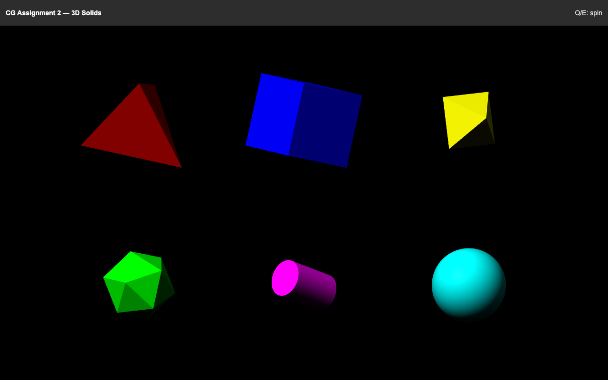

# Computer Graphics — Assignment 2

Six rotating 3D solids built from explicit vertices, triangles and outward normals, rendered with Babylon.js.

## Preview



The top row contains a tetrahedron, cube and octahedron; the bottom row contains an icosahedron, cylinder and sphere.

## Features

- Immutable Point4f and Vector4f arithmetic with homogeneous coordinates.
- Flat normals for polyhedra, smooth radial normals for the cylinder side and sphere.
- Golden-ratio icosahedron coordinates and parametric curved surfaces.
- No automatic mesh builders or normal calculation in the assessed geometry.

## Run

```sh
python3 -m http.server 8000
```

Open http://localhost:8000. Internet access is required for the provided Babylon.js CDN script. Hold Q or E to adjust rotation.

## Source

- `src/math.js`: point/vector operations.
- `src/solids.js`: explicit solid geometry and normals.
- `src/main.js` and `src/geometry.js`: supplied rendering framework.

The prescribed sphere grid includes degenerate triangles at its poles to retain the required triangle count.

## Credits

The starter framework and tetrahedron were supplied with the course assignment. Math and geometry implementations were completed with OpenAI Codex assistance.
